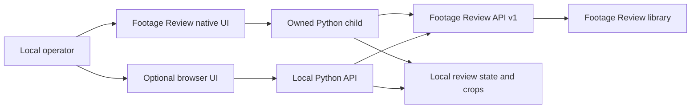
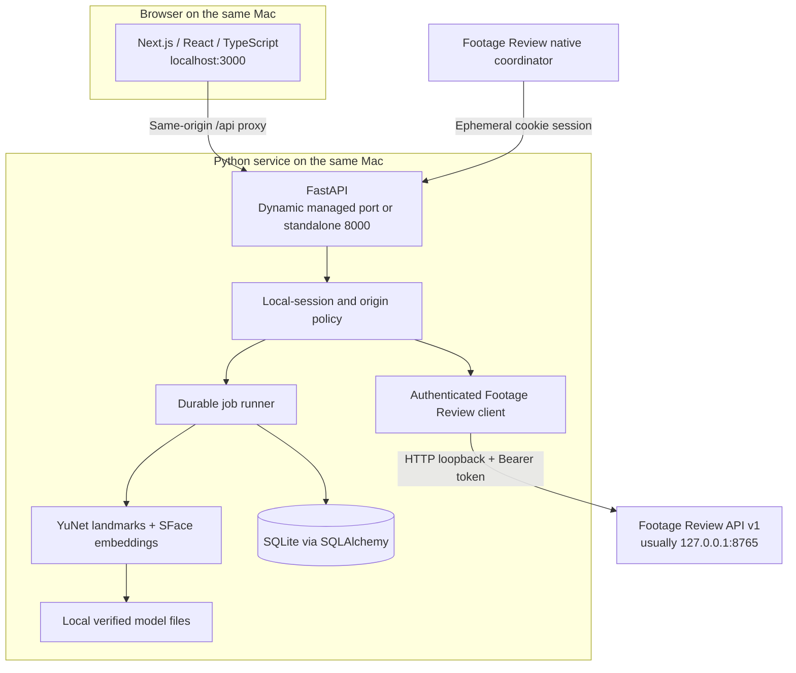

# Architecture

## Purpose and boundaries

One local operator exports existing Footage Review detections, reviews face-similarity suggestions, and explicitly submits approved groups. Footage Review 1.3 supplies native controls that start the integration API and a dedicated Python child. The optional browser client connects manually to the same API v1. Footage Review owns the library and saved group revision; Cluster Grouper owns durable exports and review drafts.

## Containers

Native mode runs no Next.js or browser process. Its coordinator launches `app.managed`, exchanges an in-memory bootstrap secret over stdin, verifies readiness and establishes an ephemeral operator cookie before connecting with Footage Review's current token. The managed backend binds only an assigned loopback port and rejects browser origins. The [native interface contract](native-integration-contract.md) defines ownership and shutdown.

The optional browser uses the Next.js proxy. Footage Review sees an authenticated server client rather than browser CORS requests, so its browser-origin field can remain blank. Standalone host/origin checks constrain local web access.

## Components and workflow

1. **Connection service:** validates a literal HTTP loopback endpoint, reads authenticated health and group state, and retains credentials only in memory. A local HttpOnly session cookie authorizes review operations.
2. **Export worker:** reads groups before appearances, checkpoints opaque cursors, and validates library, revision, and snapshot consistency across pages. It stores JPEG bytes in SQLite and follows `next_cursor` until `null`, including short pages. Only a complete export becomes eligible for imports.
3. **Embedding worker:** decodes stored JPEGs, locates a usable face and landmarks with YuNet, aligns it, and generates a normalized SFace embedding. Unusable crops remain recorded with an explicit error.
4. **Clustering service:** compares embeddings with cosine similarity and uses deterministic greedy grouping with an all-pairs threshold check to avoid transitive chains that merge weakly related endpoints. This is not a globally optimal agglomerative algorithm. Existing human-reviewed/manual memberships are excluded, and new suggestions remain unreviewed. The export limit is 50,000 appearances; the upstream 10,000-assignment import bound does not cap local comparison.
5. **Review service:** stores names, notes, complete membership, review state, and provenance. Existing groups carry all exported membership IDs, even when the current filters omit some crops.
6. **Import service:** validates reviewed changes, saves an immutable payload, and submits those exact bytes only after an explicit user action. It retains uncertain results for replay with the same import UUID.

## Persistence and recovery

SQLite stores workspace state, groups, progress, crop bytes, embeddings, and import payloads. Native mode stores this database in the library's `Clustering` directory and adds `NativeRun.json` with non-secret workspace/job references. Native Settings date/source/camera values define exact-match scope for a new run, independently of main-window selection. Model weights remain separate repository-local files.

Jobs are single-process and checkpointed; a restarted service leaves interrupted jobs paused. Native stdin EOF initiates graceful child shutdown and pause. Opening the native app restores saved metadata without starting a job; completed results and interrupted work are explicitly reopened or resumed. A cancelled or failed partial export cannot be imported. Snapshot expiration requires a fresh export and reconciliation. Offline local review does not require retaining upstream credentials.

This local design intentionally replaces the generic Postgres/Redis defaults with SQLite and a durable worker. It supports one service process and one operator. It is not a distributed queue. Do not start several Uvicorn workers against the same state directory.

## Observability and external services

Job phase, counters and errors are visible in both interfaces. Standalone structured logs support local troubleshooting without tokens or crop data. Managed mode reserves stdout for its single readiness record and limits stderr to fixed, redacted operational errors. Dependency installation and explicit model setup use external package/model sources; normal face processing has no external inference provider. No telemetry exporter is enabled by default.

## Decisions and limits

See [ADR 001](adr/001-local-stack.md), [ADR 002](adr/002-local-auth.md), [ADR 003](adr/003-durable-local-state.md), and [ADR 004](adr/004-reviewable-face-suggestions.md). Accuracy on real footage, installed Footage Review acceptance, and operational privacy controls require separate evidence described in the [delivery checklist](delivery-checklist.md).
