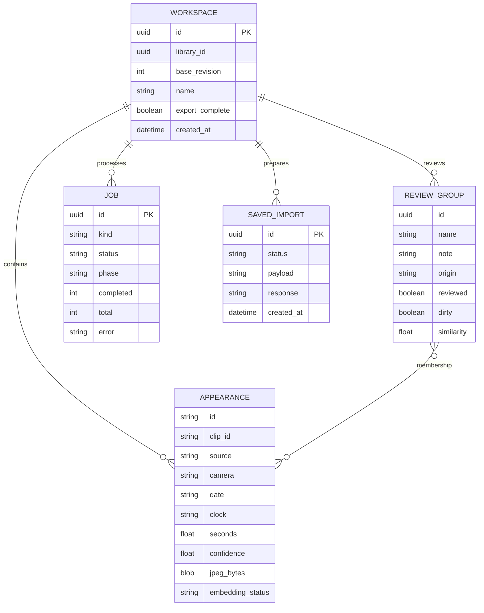

# Data model

## Authority

Footage Review owns `library_id`, appearance IDs, existing group UUIDs, and group revisions. Cluster Grouper preserves those values. A workspace binds review decisions to one exported library and one reviewed base revision. An appearance ID represents a detection at a clip offset; it does not identify a unique person.

This ERD describes logical entities and relationships. Complete membership may be stored as JSON rather than as join-table rows. The Alembic migration is the authority for physical table and column names.

## Invariants

| Entity | Required invariant |
|---|---|
| Workspace | Review state never silently changes to another library or base revision. |
| Export | All pages belong to the expected library/revision/snapshot; completion requires a null cursor and consistent counts. |
| Appearance | Original ID and clip offset remain unchanged; JPEG bytes stay in the local database and are served through authenticated crop routes. |
| Group | Membership is a complete set of original appearance IDs. Existing off-filter members are retained unless explicitly edited. |
| Review | New model suggestions remain unreviewed. Substantive group edits invalidate earlier approval unless reviewed again. |
| Job | Completion reflects durable finished work. Failed, cancelled, paused, and queued states remain distinct. |
| Saved import | The UUID and serialized payload remain unchanged across retries. A new intended update uses a new import UUID. |
| Credentials | Footage Review token and local session secret are memory-only and never part of this model. |

## Group provenance

- `existing`: read from Footage Review; complete upstream membership is preserved.
- `suggested`: generated from local embeddings; requires human review.
- `manual`: created by the operator from selected appearances.

An appearance may belong to more than one group. A group can contain no appearances; submitting that group clears its upstream membership. Groups absent from an import remain unchanged upstream.

## Lifecycle

Jobs checkpoint progress so an interrupted process can resume explicitly. Embedding failures are stored per appearance and remain visible. Submitted imports retain the response, including replay status and import/current revisions. Review drafts are not automatically erased. See [runbook](runbook.md) for local backup and retention procedures and [DPIA-lite](dpia-lite.md) for data categories.
